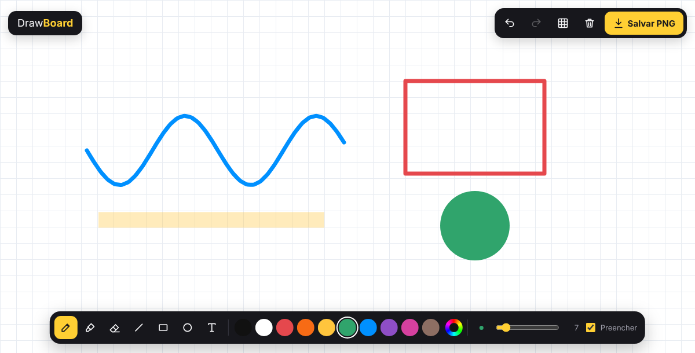

# DrawBoard — Lousa digital

Lousa digital com desenho livre, borracha, troca de cor e espessura e opção de salvar a imagem em PNG.

🔗 **[Ver o site no ar](https://iamviniciuslima05.github.io/PROJETO-DrawBoard/)**



## Funcionalidades

- **Lápis**, **marca-texto** e **borracha**
- Formas: **linha, retângulo e círculo** (Shift deixa proporcional)
- Ferramenta de **texto**
- **Cores** prontas e cor livre
- **Espessura** ajustável
- **Desfazer e refazer** (Ctrl+Z / Ctrl+Y)
- Fundo liso, quadriculado, pontilhado ou **lousa escura**
- **Salvar como PNG**
- Funciona com **mouse, toque e caneta**

## Tecnologias

HTML5 · CSS3 · JavaScript · Canvas · Pointer Events

## Estrutura

```
index.html
css/style.css
js/script.js
```

## Como rodar

Não precisa instalar nada: baixe o projeto e abra o `index.html` no navegador, ou acesse a versão publicada acima.

---
Feito por **Vinicius Lima** · [Portfólio](https://viniciuslimadev.netlify.app) · [LinkedIn](https://www.linkedin.com/in/viniciuslima25/)
